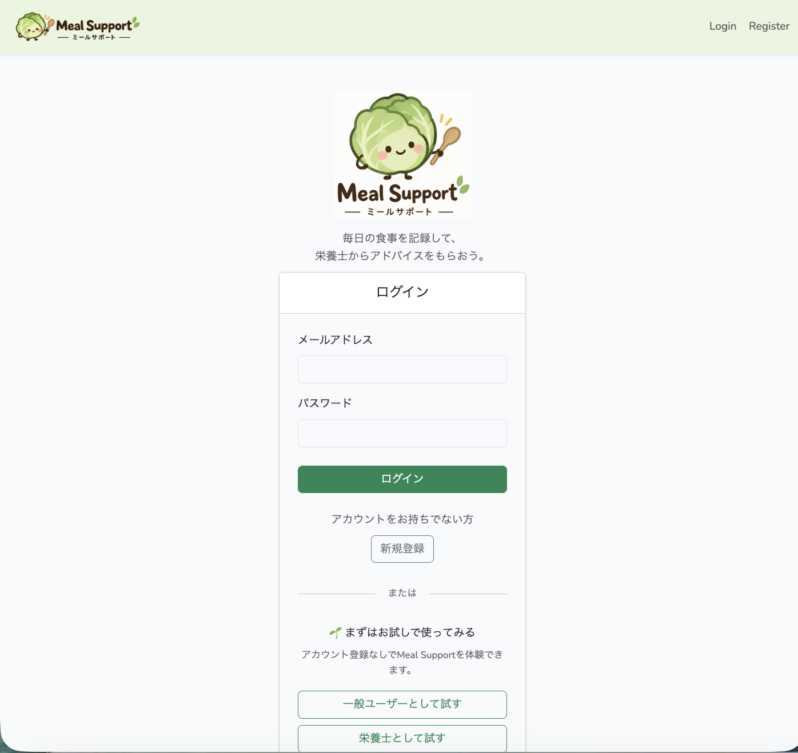
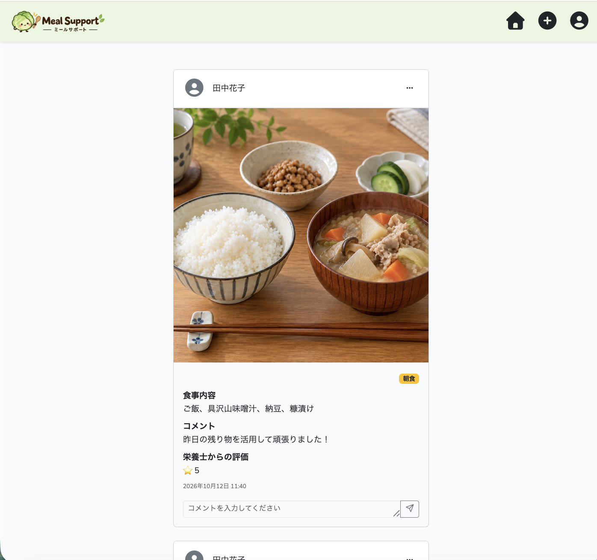
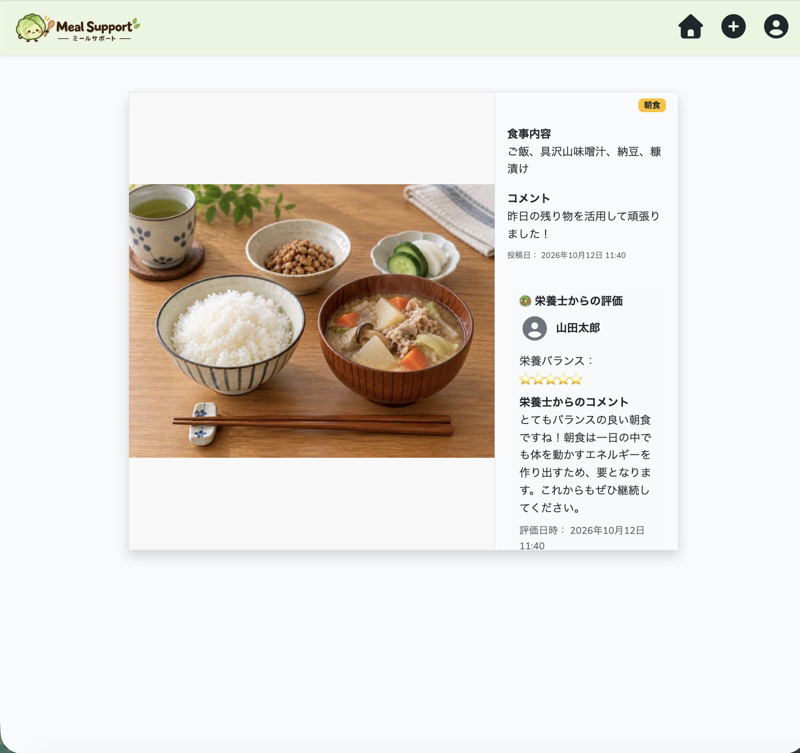
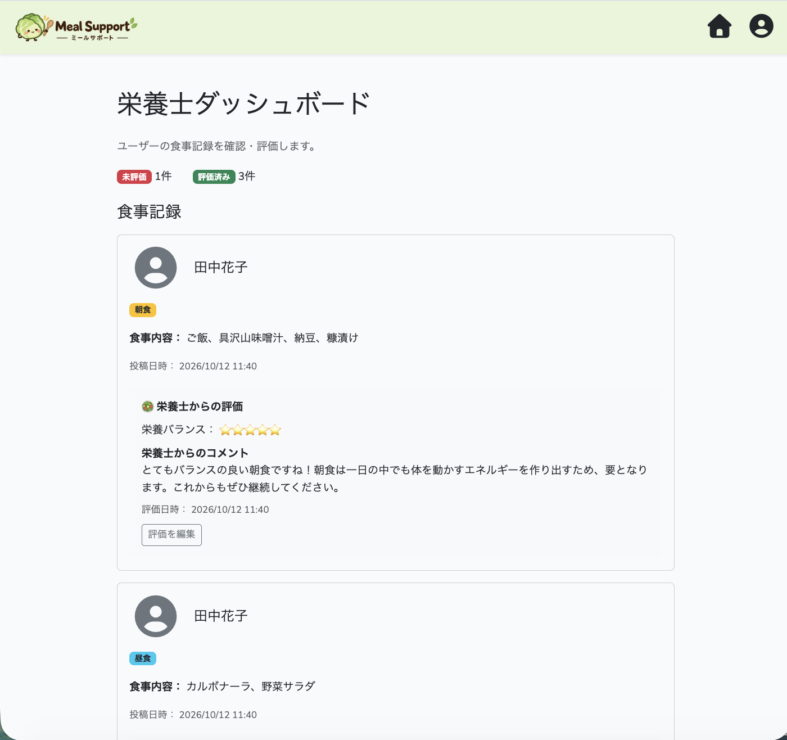
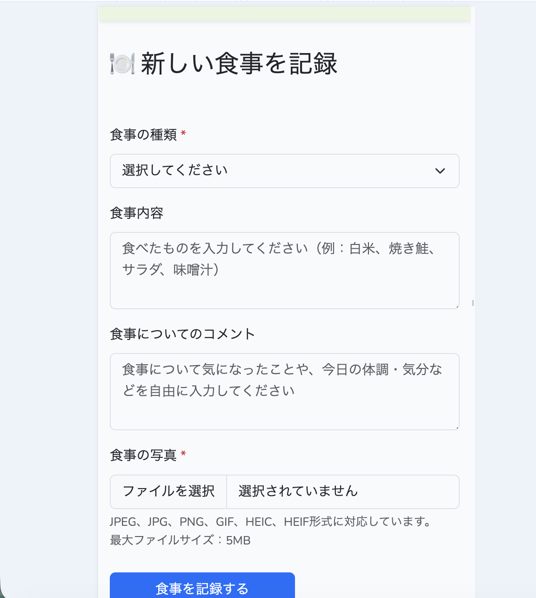

# Meal Support

## 1. アプリケーション概要

Meal Supportは、食事の記録と栄養士からのフィードバックを通じて、利用者の食生活の改善をサポートするWebアプリケーションです。

利用者は日々の食事を投稿し、栄養士は投稿された食事内容を確認して、コメントや評価を通じたフィードバックを行います。

利用者と栄養士が継続的につながることで、日々の食生活を振り返り、よりよい食習慣を身につけることを目指しています。

## 2. 開発背景・解決したい課題

私は管理栄養士として働く中で、食事指導を行った後、利用者の食生活が実際にどのように変化したのかを把握することの難しさを感じていました。

また、食生活の改善には、知識を伝えるだけでなく、日々の食事に寄り添い、継続的にサポートすることが大切だと考えています。

そこで、利用者が日々の食事を記録し、栄養士がその内容を確認してフィードバックできる仕組みを作りたいと考え、Meal Supportを開発しました。

食事の記録と栄養士からのフィードバックを通じて、利用者が自分の食生活を振り返り、継続的な改善につなげられるサービスを目指しています。

## 3. 画面・利用方法

※本アプリケーションは現在、ローカル環境で動作確認を行っています。公開用のデモサイトは用意していないため、画面のスクリーンショットとセットアップ手順を掲載しています。

### ログイン画面



ログイン画面から、ユーザー登録・ログインができます。

また、「一般ユーザーとして試す」「栄養士として試す」のボタンから、それぞれの立場でアプリの機能を体験できます。

### 食事一覧画面



投稿された食事の写真や内容を一覧で確認できます。

食事カテゴリーを表示することで、それぞれの投稿がどの食事に当たるのかを確認しやすくしました。

### 食事詳細画面



食事の投稿内容を確認できるほか、栄養士からのコメントや評価を通じて、食生活を振り返ることができます。

### 栄養士側の画面



栄養士専用のダッシュボードでは、利用者の食事記録を一覧で確認できます。

食事内容を確認し、評価やコメントを通じて、利用者にフィードバックを行うことができます。

### スマートフォン表示



食事の種類や食事内容、コメント、写真を登録できます。

スマートフォンからも食事を記録しやすいよう、画面幅に応じてレイアウトが調整されるレスポンシブデザインを採用しました。

## 4. 使用技術

| 技術 | 用途 | 選定理由 |
|---|---|---|
| PHP 8.2以上 | アプリケーションの処理 | Laravelを利用したWebアプリケーションの開発に使用 |
| Laravel 12 | Webアプリケーション開発 | ユーザー認証やデータベース操作などを実装するため |
| MySQL | データベース | ユーザー情報、食事投稿、コメント、評価などを管理するため |
| HTML / CSS | 画面の構築・装飾 | 利用者と栄養士が操作する画面を作成するため |
| Bootstrap | レイアウト・デザイン | スマートフォンでも利用しやすい画面を作るため |
| Imagick（PHP拡張機能） | 画像処理 | HEIC・HEIF形式の画像をJPEG形式に変換するため |
| Vite | フロントエンドの開発・ビルド | CSSやJavaScriptなどの開発用アセットを管理するため |
| Git / GitHub | バージョン管理・コード共有 | ソースコードの変更履歴を管理し、コードを公開するため |

## 5. 主な機能

### 利用者向け機能

- ユーザー登録・ログイン
- 食事の写真・内容の投稿
- 投稿の編集・削除
- 食事カテゴリーの選択・表示
- 栄養士からのコメントの確認
- 栄養士による評価の確認
- プロフィールの表示・編集

### 栄養士向け機能

- 投稿された食事内容の確認
- 利用者へのコメント
- 食事内容の評価
- プロフィールの表示・編集

### その他

- 利用者と栄養士の役割に応じた機能・画面の切り分け
- 役割に応じたアクセス制御
- スマートフォンに対応したレイアウト
- HEIC形式の画像をJPEG形式に変換する処理

## 6. 工夫した点・設計判断

### 6-1. 利用者の使いやすさを意識したスマートフォン対応

日常的に食事を記録することを想定し、スマートフォンから手軽に食事の写真を投稿できるよう、画面レイアウトを調整しました。

開発者の視点だけでなく、利用者が日常生活の中で無理なく食事を記録し、栄養士とつながれることを意識しました。

### 6-2. 継続的なコミュニケーションを意識したコメント機能

1つの食事投稿に対して、利用者と栄養士が複数回コメントをやり取りできる仕組みを実装しました。

栄養士が利用者の質問に答えたり、食事内容に応じたアドバイスを追加したりできるようにすることで、継続的な食生活のサポートを目指しました。

### 6-3. スマートフォンで撮影した画像への対応

スマートフォンで撮影した写真を投稿できるよう、HEIC形式の画像をJPEG形式に変換して扱う仕組みを実装しました。

画像形式の違いを考慮し、利用者がスムーズに写真を投稿できることを目指しました。

### 6-4. 利用者と栄養士の役割に応じた機能設計

利用者と栄養士では必要な機能が異なるため、それぞれの役割に応じて画面と機能を分けました。

また、役割に応じたアクセス制御を実装し、利用者が栄養士向けの機能を操作できないようにしました。

## 7. セットアップ方法

### 必要な環境

- PHP 8.2以上
- Composer
- Node.js / npm
- MySQL
- Laravel 12
- ImageMagick（HEIC形式に対応したもの）
- PHP Imagick拡張機能

※HEIC・HEIF形式の画像をJPEG形式に変換する機能を利用するには、ImageMagickとPHP Imagick拡張機能が必要です。

### インストール手順

#### 1. リポジトリを取得する

GitHubからリポジトリを取得し、プロジェクトのディレクトリに移動します。

```bash
git clone <GitHubリポジトリのURL>
cd meal-support
```

#### 2. PHPの依存パッケージをインストールする

```bash
composer install
```

#### 3. 環境設定ファイルを作成する

```bash
cp .env.example .env
```

`.env` を開き、データベースの接続情報を自分の環境に合わせて設定します。

#### 4. データベースを作成する

MySQLで `meal_support` という名前のデータベースを作成します。

`.env` のデータベース設定も、作成したデータベースに合わせて変更してください。

#### 5. アプリケーションキーを生成する

```bash
php artisan key:generate
```

#### 6. データベースのテーブルを作成する

```bash
php artisan migrate
```

#### 7. デモデータを登録する

以下のコマンドを実行すると、デモ用のアカウント、食事投稿、カテゴリー、栄養士による評価が登録されます。

```bash
php artisan db:seed
```

デモデータを登録するには、`database/seed_images/posts/` に含まれる画像ファイルが必要です。

※新しく作成したデータベースに対して実行してください。既存のデータがあるデータベースでは、重複登録などによりエラーになる場合があります。

※シーダーの実行時には、投稿画像の保存先にある既存のファイルが削除され、デモ用画像に置き換えられます。必要な画像がある場合は、事前にバックアップしてください。

#### 8. ストレージへのシンボリックリンクを作成する

```bash
php artisan storage:link
```

#### 9. JavaScriptの依存パッケージをインストールする

```bash
npm install
```

#### 10. アプリケーションを起動する

ターミナルで以下を実行します。

```bash
php artisan serve
```

別のターミナルを開き、以下を実行します。

```bash
npm run dev
```

ブラウザで以下にアクセスします。

http://127.0.0.1:8000

## 8. テスト・動作確認

以下の機能について、ブラウザ上で手動テストを実施しました。

- ユーザー登録・ログイン
- 食事の投稿・編集・削除
- カテゴリーの選択・表示
- コメントの投稿
- 栄養士による評価
- 利用者と栄養士の権限に応じた画面表示
- スマートフォンでの画面表示
- HEIC形式の画像の投稿

※自動テストは未実装です。

## 9. 未実装部分と今後の改善

### 現在できること

- 利用者が食事の写真や内容を投稿し、栄養士がコメントや評価を登録できる。
- 栄養士が利用者の食事投稿を確認し、フィードバックを行える。
- 1つの食事投稿に対して、利用者と栄養士が複数回コメントをやり取りできる。

### 現在できないこと

- 栄養士側で、利用者ごとに食事投稿を分けて確認する機能。
- 栄養士からコメントや評価が登録された際に、利用者へ通知する機能。

### 次に改善すること

- **利用者ごとの投稿管理**

  栄養士が利用者ごとに食事投稿を確認できるようにし、一人ひとりの食生活の傾向や変化を把握しやすくすることで、継続的な栄養指導につなげる。

- **通知機能の追加**

  栄養士からコメントや評価が登録された際に利用者へ通知し、フィードバックの見落としを防ぐことで、食生活の改善につなげやすくする。